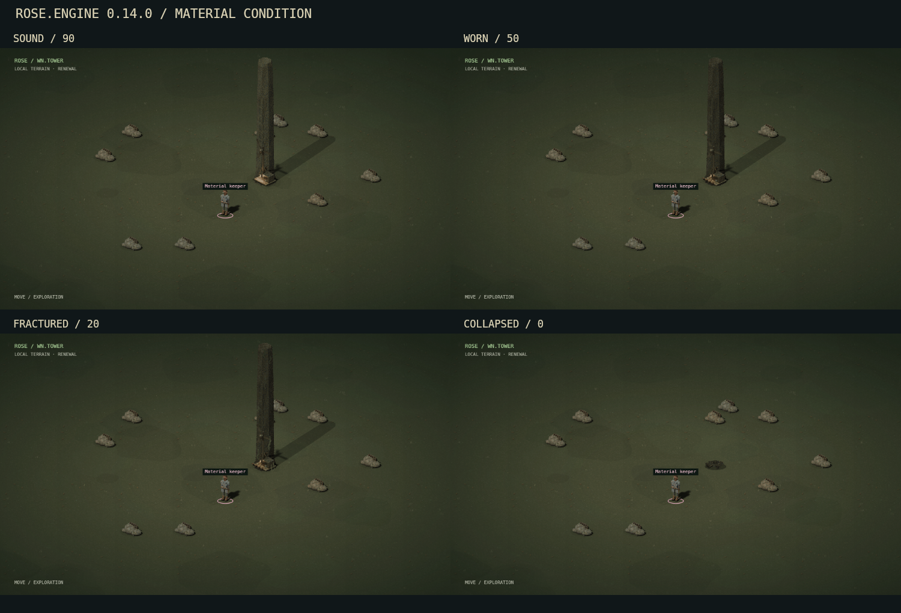

# Rose 0.14.0 — Material aging and destruction

**Systems update · 4 October 2026 · world/blueprint schema 1 retained**

Buildings, active construction, stone props, weapons and registered equipment now retain their condition, accumulated exposure and recovery receipts. Wear can disable equipment or collapse a structure. Clearing leaves a walkable foundation that can be surveyed and rebuilt through the existing construction system.

## Play controls

Open **GEAR / MATERIAL CONDITION** to inspect your field staff and installed or stored equipment. Each item shows its condition, material, exposure age and replacement generation. Inspect, Repair, Replace and Reclaim explain why they are unavailable when prerequisites are unmet. Existing NPC designations include their registered gear condition.

Select a building, project or rock through the field or **Scene Objects**. **INSPECT MATERIAL** reads condition without spending AP or a survival cycle. **STRIKE MATERIAL** applies physical damage; generated public works show **STRIKE PUBLIC WORKS** and its faction cost. A collapsed object exposes **CLEAR RUBBLE / RECOVER … SCRAP**. Physical work requires an adjacent hex.

The same actions have typed commands:

```text
inspect weapon field_staff
repair weapon field_staff
replace weapon field_staff
reclaim gear leg_spikes
inspect material structure water-1
strike material structure water-1
clear material structure water-1
strike material project project-1
clear material project project-1
inspect material hex -2,3
strike material hex -2,3
clear material hex -2,3
```

Use the actual IDs and rock coordinates shown in your field. The listed locations are examples. The material record retains recent wear, damage, maintenance and recovery results.

## Material behavior

The following are abstract condition points per world cycle. Fractional exposure accumulates until it becomes whole damage; re-reading or processing the same cycle adds no wear. High moisture means at least 70; rain also activates wet wear. Storm wear is added during particulate storms or contrail squalls. Packed equipment receives one quarter of ambient exposure.

| Material | Dry wear | Additional wet wear | Additional storm wear | Hardness | Recoverable original scrap |
| --- | ---: | ---: | ---: | ---: | ---: |
| Mineralized wood | 0.012 | 0.090 | 0.100 | 2 | 40% |
| Worked metal | 0.005 | 0.060 | 0.025 | 6 | 60% |
| Stone and earth | 0.002 | 0.005 | 0.010 | 8 | 50% |
| Crystal | 0.006 | 0.010 | 0.100 | 4 | 40% |
| Canopy fabric | 0.025 | 0.070 | 0.180 | 1 | 20% |
| Bio-polymer | 0.015 | 0.025 | 0.060 | 3 | 40% |

Regional construction defaults to wood in WN_TOWER, metal in CITY_CLOUD_S, stone in ENACT_HILLS and crystal in AETHERGALE. AETHERGALE shelters and exchange canopies use fabric. These are extensible dominant-material profiles, rather than a layered chemical simulation. Rocks use stone. Gear has individual profiles independent of the surrounding biome.

The existing infrastructure wear cycle still applies to operating works, including its moisture, drought and regional storm modifiers. Ambient exposure adds slower material aging between those cycles. Mechanical fatigue from fitted physics mechanisms routes through the same damage authority, so a fatigued machine foundation can collapse rather than become an indefinitely repairable zero-condition node.

## Condition and combat

| Condition | State | Consequence |
| --- | --- | --- |
| 60–100 | Sound | Full weapon damage; ordinary prepared appearance when operating |
| 30–59 | Worn | Weapon damage multiplier 0.8; worn surfaces |
| 1–29 | Fractured | Weapon damage multiplier 0.55; visible fractures; ordinary mod bonuses disabled |
| 0 | Ruined | Failed gear or persistent structural debris; replacement or clearance required |

Crystallin requires at least 20 condition to fire. The field staff remains usable down to 1 condition. Each accepted melee strike or shot spends 2 weapon condition, including misses. AP, range, line of sight, registration and ammunition are checked before that wear. Installed equipment used for a matching skill check during physical work loses 1 condition; observation alone adds none. Failed physical attempts can wear tools.

Deliberate material strikes make Body/Metallurgy checks with local context, faction standing and eligible companion support. Hardness raises difficulty and reduces damage; a worn staff also produces less impact. A strike in exploration costs one survival cycle. During an encounter it costs the configured melee AP, retains the same scene and leaves the world aging clock held. Clearing, replacing gear and building require exploration. Damaging generated public works costs one faction standing per accepted attempt, including misses. Other registered players cannot deliberately destroy or recover your commissioned foundation; cooperative construction remains available.

## Collapse and rebuilding

A collapsed building becomes disabled, its incident connections fail, and its tall silhouette no longer blocks sight or contributes neighboring structural cover. Debris still occupies its hex. Any shelter support added by that commissioned building is removed once. Existing utility stock remains accounted for; collapse grants no new water, power or mechanical energy. Sources and mechanism connections are reconciled without running another physics step.

Ordinary repair, toggle, supply draw and maintenance commission actions cannot resurrect a collapsed structure. **Clear Rubble** performs a checked recovery, removes the old node and links, and opens the footprint. It can then be walked across or selected for a new paid foundation. Ruined construction cannot finish or cancel for a full escrow refund; its recoverable physical material follows the same finite budget.

Completed construction inherits its project's actual condition and material clock. Building completion does not reset weather damage. Destroyed rocks likewise lose sight obstruction and cover, remain blocked until cleared, then become open ground.

## Maintenance and recovery accounting

Repairing living gear costs 1 scrap and restores 25 condition, capped at 100. Failed repairs consume that input. Destroyed gear needs replacement. Replacement costs 2 scrap, gives a new persistent generation and closes the old shell. The field staff can be replaced in the field; regulated equipment requires installation, Black.Dot registration and adjacency to a maintained workshop. Failed replacement work spends its input without issuing a new item. Removing and reinstalling equipment preserves its existing identity and condition.

Reclaiming a destroyed shell is checked and allowed once. Clearing a structure or project transfers only its original recoverable material. Recovery uses the integer floor of embodied scrap multiplied by the profile's recovery percentage; repair inputs are consumed maintenance and do not inflate that budget. A full pack blocks recovery before changing the object. Failed recovery leaves the debris and pending salvage intact. Closed receipts and local recovered/lost totals persist through saves. Retired gear history and visible event histories are bounded.

NPC repair/support cycles can spend their own scrap on a worn staff before continuing infrastructure work. Their existing skill, attitude, energy and work-cycle rules remain authoritative. They do not restore collapsed buildings for free.

## Graphics, persistence and scope

Worn prepared assets remain in use. Props without a prepared worn frame gain deterministic surface staining. Severe damage uses cracks, and collapse uses low piles assembled from the actual object's prepared surface pixels, including monument materials. Drawing, bounds, enlarged inspection and picking share those resulting frames; graded shadows cannot capture a cursor. The derived-frame cache holds at most 32 entries. The earlier art banks and vector fallback also show rubble.



This is a practical prototype damage system. It does not add a new Blender fracture bake, rigid-body debris, chemically calibrated lifetimes, fire propagation, layered building components or individual aging for bulk food/water inventory. The original Blender sources, prepared sprite PNGs and hidden VREX/physics measurement modules retain their bytes and presentation. Material condition is ordinary gameplay information; particulate metrology remains off screen.

Existing schema-1 saves initialize missing material records at their current world cycle while preserving existing structural condition. A previously recorded zero-condition building migrates into rubble. No retroactive elapsed-time damage is charged. Gear and object clocks, pending salvage and ruins persist through SQLite restart. Automatic world time and aging stay held during tactical encounters.

## Verification

The complete Python suite passes **372 tests**, including 37 new behavioral regressions for weather rates, deduplicated clocks, miss wear, AP guards, broken bonuses, real uninstall/reinstall, paid repairs, replacement identities, finite recovery, ownership, collapse, cover, construction transfer, rock clearance, cold migration, zero-condition migration and SQLite persistence. The real-host material flow exercises approach, demolition, staff wear, repair, clearing, duplicate rejection and individual rock menus.

Native canvas controls compare four condition states for water, power, relay, shelter and rock in all four regions. They verify lower debris silhouettes, solid-pixel ownership, shadow rejection, bounded caches and legacy/vector fallbacks. The preview comes from that field renderer. Full-browser layout, device performance and long-term gameplay balance remain unverified. See `material-aging-audit-v014.json`, `validation-results-v014.json` and `VALIDATION.md` for recorded results.
