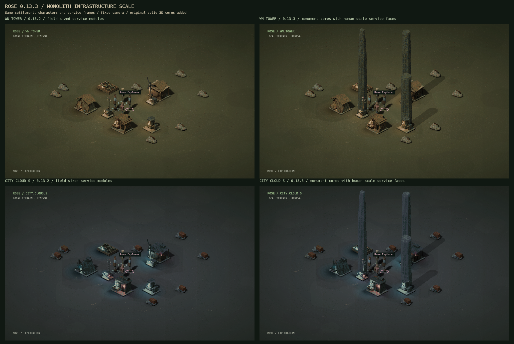

# Rose 0.13.3 — Monolith infrastructure scale

4 October 2026 · systems and presentation update

Water, power and relay works now combine human-scale service modules with solid vertical monument cores. The base hardware remains readable beside characters, while the upper mass identifies each function at settlement scale. Other buildings retain their existing proportions.



## Scale and association

| Service | Monument association | Native opaque height | Character-height ratio |
| --- | --- | ---: | ---: |
| Water | Reservoir monolith | 241.33 px | 3.81 |
| Power | Collector backbone | 304.67 px | 4.81 |
| Relay | Route signal monument | 362.00 px | 5.72 |

These measurements use the actual composed frame beside a 63.33 px standing character at the default radius-six field scale. Larger field radii scale both together. Pixel ratios establish a readable hierarchy; mesh units are abstract game units, without a metre or planetary conversion. Existing terrain elevation and foot registration still place each object.

Each core is a closed, capped octagonal mesh with positive volume. Tapered courses and a solid crown produce continuous mass rather than enlarged service fixtures. Its widest horizontal extent fits within the existing blocked node cell; paths and interaction aprons remain accessible. The base service, node ID, condition, network connection, repair target and public-stock ownership are retained.

| Region | Core material | Retained service lighting |
| --- | --- | --- |
| WN_TOWER | Mineralized darkwood | Jade and amber |
| ENACT_HILLS | Worked basalt and earth composite | Ochre and jade |
| CITY_CLOUD_S | Solid alloy and ceramic | Cyan and rose |
| AETHERGALE | Dense faceted crystal | Violet with jade and rose |

Regional cores have idle and worn frames. Condition and offline status choose the same worn state as the corresponding service. Existing practical fixtures remain at their human-scale offsets and obey their original power rules. No new crown emitter or resource-producing apparatus is implied by the silhouette.

## One registered appearance

The Detailed / Regional Spectrum bank composes a core behind its service frame at their shared foot origin. Rendering, opaque bounds, alpha selection, player occlusion, enlarged inspection and construction reveal use that composed frame. Transparent padding and translucent projected shadows cannot select the structure. A foreground core fades when it covers the player, who remains selectable through it. Foundation, frame and finishing projects expose only their currently built portion.

The sprite composition cache retains at most twenty-four entries. Existing radiance, terrain and display caches keep their prior bounds. Archive, painted material and vector choices retain their prior appearance. The fixed viewport may crop a distant monument's upper silhouette; the current-field appearance inspector fits the complete opaque structure.

## Sources and rebuild

| File | Purpose |
| --- | --- |
| `art-source/monoliths-v1/models.json` | Twelve complete solid meshes, abstract proportions, materials and projection |
| `art-source/monoliths-v1/render-record.json` | Source checksum and checksums for all twelve atlases |
| `tools/build_monoliths.py` | Original software 3D authoring and rasterization tool |
| `static/art/rose-monolith-*-v1.png` | Twenty-four prepared idle/worn frames in twelve indexed atlases |
| `static/art-manifest-rendered.json` | Associations for regional service frames, tones and aliases |
| `static/prefabs.js` | Registered composition, bounds and picking |
| `tests/test_monoliths.py`, `tests/ui-monoliths.cjs` | Geometry, receipts and native integration controls |

Authoring requires NumPy and Pillow. After editing `DESIGNS` or `MATERIALS`, run from the extracted `rose` folder:

```sh
python3 tools/build_monoliths.py
python3 -m unittest discover -s tests -p test_monoliths.py -v
node tests/ui-smoke.cjs --monoliths
```

After a fresh export of the retained Blender bank, rerun `build_monoliths.py` to restore the associations. The tool uses a fixed dimetric projection, directional face lighting, fine material grain, masked wear and shadows projected from actual mesh vertices. It supersamples at 2× and exports through the shared v6 palette: transparent index, sixteen graded shadow slots and 239 opaque colors. Its 640 × 832 frames contain the complete shadows.

This is a separate original software 3D bake, rather than a new Blender/Cycles render. The prior 46 Blender models and 1,244 raw frames remain retained. Adding the cores yields 132 current indexed PNGs and 144 game entries; original sprite PNGs and the Blender sources remain unchanged.

## Verification and limits

The complete suite passes **335 Python tests in 27.481 seconds**. The real-HTTP/native interface flow passes, including regional scale, service registration, high-pixel selection, transparent padding, player fade-through, construction clipping, bounded composition and unchanged host state. Matched WN/CITY fields retain all 113 navigation paths each. `monolith-scale-audit-v0133.json` records the measured ratios.

Native canvas with a modeled DOM verifies drawing and application behavior; complete browser layout and Windows execution remain unverified. Monument meshes improve proportion and material direction within the prototype. Bespoke sculpted surfaces, interiors, talking portraits and finished hyper-realistic asset production remain future work. These dimensions do not add new physical capacity, reinterpret VREX measurements or establish literal continental/planetary scale.
