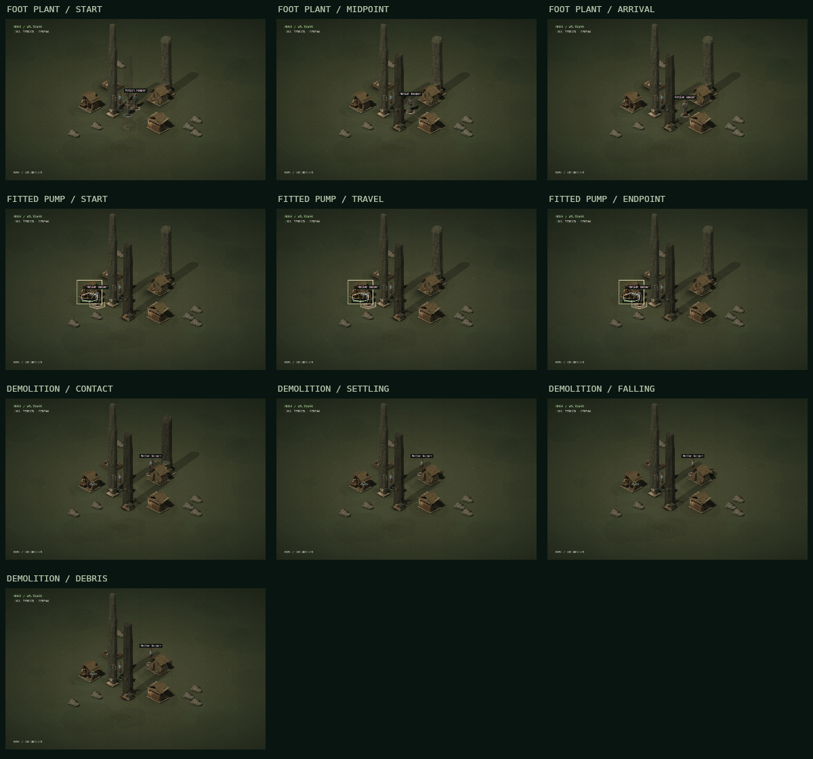

# Rose.ENGINE 0.15.0 — Physics interaction animations

Rose now plays motion from committed game actions and sampled workshop solver poses. Walking, attacks, recoil, material impacts, collapse and fitted hardware share the existing prepared sprites, ground registration, lighting and solid-pixel selection. Physics measurements stay outside the game screen.

## Controls

The local field includes **Motion: System / Full / Reduced**. System follows the operating system's reduced-motion preference. Full plays the prepared motion sequences. Reduced shows the current settled state, including the actual hardware endpoint, and suppresses recoil, tracers and settling effects. The choice is saved on that client and spends no resources or turns.

Use the existing movement, combat, material and workshop controls. There is no separate animation action. New clients, restored sessions and scene changes show the settled world rather than replaying historical actions. Failed prerequisites create no attack or work cue. A checked miss retains the attack motion and its paid costs, with no target recoil or hit flash.

## Behavior

| Interaction | Motion authority | Visible response |
| --- | --- | --- |
| Local walking and NPC pursuit | Committed, contiguous axial path | Six-direction facing, interpolation of ground elevation and one prepared footstep per hex |
| Melee | Confirmed AP action and skill result | Prepared wind-up, contact at 435 ms, then damage-dependent target recoil |
| Crystallin shot | Confirmed AP/ammunition action and range | Prepared attack, short tracer, distance-dependent contact and confirmed-hit response |
| Adjacent companion guard | One enemy attack and its committed damage shares | Both recipients react at the same contact; the attacker plays one strike |
| Material strike | Existing condition-loss result and material profile | Small material-specific shudder at contact, plus the current wear/fracture appearance |
| Structural, project or rock failure | First authoritative collapse | Prepared surfaces break into bounded falling fragments and settle into the registered low debris silhouette |
| Rubble clearance | Successful once-only recovery | A brief dust response at the cleared footprint |
| Pump, press and damper | Actual downstream solver samples | Rail carriage and movable hardware follow the saved poses, hold the final endpoint and park on shutdown |

Movement uses 360 ms per hex, with two foot plants per prepared walk cycle. Attacks use the existing 870 ms clip and confirmed-hit reactions use 540 ms. Collapse uses a 1,200 ms presentation interval. These are game presentation timings; they are not calibrated physical seconds or real-world material measurements.

Workshop playback covers the committed solver interval, normally 500 ms per ecological step. A bounded sequence contains an initial pose and subsequent samples. The renderer interpolates only within that sequence and holds its final pose. It does not invent continuing oscillation between host updates. Pump, press and damper carriages follow the current horizontal rail model; the damper spring is anchored to the fixed housing. Contact changes the hardware accent. Disengagement, outages and fatigue failure publish a parked pose with no motion interval. Restoring a workshop does not recreate spent drive or restart operation.

## Synchronization and persistence

Each scene retains up to 96 ordered action cues with a monotonic serial. The client consumes each serial once. Actor movement finishes before the actor's next attack. Hit reactions begin at that attack's contact, and collapse follows the target's final hit response. Shared guard damage is carried inside the same attack cue.

The client holds at most 96 subject tracks, 12 queued cues per track and 24 composed motion surfaces. Excessive pending delay is bounded; missing history is consumed into the current settled state. These presentation limits never remove committed game actions, inventory costs, damage or recovery records.

Pausing freezes the local playback clock. Resume continues from the frozen position. Remote observation and void entry discard pending local playback while consuming new serials; returning does not replay hidden actions. Combat can play AP actions while the ecological clock is held. Fitted hardware remains at its last committed solver pose during that hold.

The renderer draws, inspects, computes bounds and picks from the same current composed frame. Moving parts and falling opaque fragments remain selectable. Projected shadows and transparent margins do not become click targets. Ground footprints, line of sight, occupancy, AP, ammunition, power, salvage and contract authority remain on the host.

Existing saves initialize an empty cue stream on first use. There is no migration cost and no invented past action. The cue stream and curated mechanism poses survive the existing SQLite save/restart flow. Repeated snapshots and rendering add no solver steps, energy or resource receipts.

## Rendering scope

The original Blender sources, prepared PNGs, palettes and art manifests are retained. New sequences combine those surfaces with small canvas hardware details, damage recoil and material-dependent falling/settling trajectories. Regional lighting, CRT profiles, hidden navigation cells, monolith proportions and the appearance inspector remain integrated.

These are prototype prepared-surface animation compositions. Structural fragments are deterministic visual trajectories with bounded bounce; they are not individually simulated rigid bodies. Weapon flex, cloth, fluids, ragdolls, articulated doors and fresh Blender animation bakes remain production work. Vector fallback retains movement and existing poses; moving hardware and fragment composition require a prepared sprite bank.

No numerical VREX, TETHER, solver, energy or cross-correlation history is added to the game UI or narrator context. Curated hardware samples contain only normalized phase, local pixel offset, angle and contact/sleep state. Actual engineering records remain available through the existing off-screen development exports.

## Verification

The release adds 19 host cases covering action ordering, all six headings, AP-held timing, misses, rejected prerequisites, shared guards, once-only collapse/clear, bounded detached cue history, SQLite restoration, prior-save hardware poses, exact solver endpoints, shutdown, no-input controls, held clocks and public-data boundaries. Native client controls cover deduplication, queue bounds, ground registration, contact-time recoil, pause/resume, profile changes, remote/void transitions, no extrapolation and drawing/picking consistency for all four regions.

Run the complete suites:

```bash
python3 -m unittest discover -s tests -v
node tests/ui-smoke.cjs
```

Run only the new animation flows:

```bash
python3 -m unittest discover -s tests -p test_animations.py -v
node tests/ui-smoke.cjs --animations
```

The preview is produced by the actual native field renderer and confirmed HTTP actions. It is not a full browser screenshot. Full browser layout, audible playback, live pointer/touch hardware, LAN sessions and human balance remain unverified. Release logs and receipts are in `VALIDATION.md`, `validation-results-v015.json` and `code-audit-v015.json`.



[Animated demolition preview](Rose-physics-animation-preview.gif)
